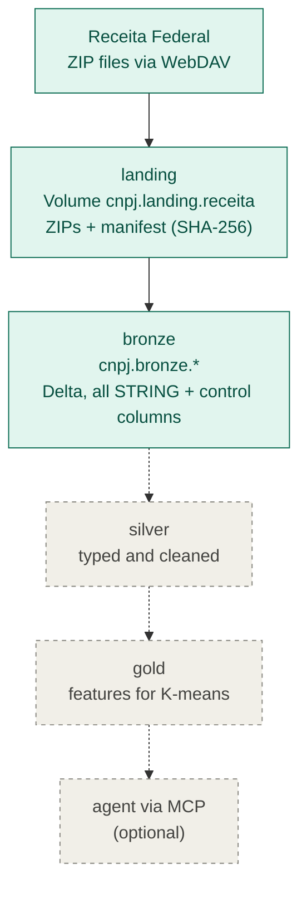

# cnpj-lakehouse

Lakehouse pipeline for Brazilian company registry (CNPJ) open data from Receita Federal, built on Databricks with **Delta Lake** and **Unity Catalog**, following the medallion architecture (landing, bronze, silver, gold).

*Pipeline de dados sobre os dados abertos de CNPJ da Receita Federal, no Databricks com Delta Lake e Unity Catalog, em arquitetura medalhão. [Versão em português abaixo.](#em-português)*



*Solid: done. Dashed: planned. / Contínuo: feito. Tracejado: planejado.*

## Status

| Phase | Scope | Status |
|---|---|---|
| 1 | Ingestion to a Unity Catalog Volume, bronze/silver/gold in Delta, grants and lineage | landing and bronze **done**; silver and gold next |
| 2 | K-means clustering with MLflow tracking | planned |
| 3 | CI/CD with Databricks Asset Bundles and GitHub Actions | planned |
| 4 | Agent querying the gold layer via MCP (optional) | planned |

## Current scope

- **Source:** Receita Federal CNPJ open data, monthly full snapshots (~7 GB compressed, 37 files), downloaded directly via WebDAV.
- **Study slice:** reference month 2026-10, one file of each large table, the Simples Nacional file and 6 lookup tables (780 MB compressed, 4.81 GB uncompressed).
- **Environment:** Databricks Free Edition (serverless). Code is edited locally, versioned here and synced to Databricks through a Git folder. The serverless environment version is pinned in each notebook header.

## Unity Catalog

- Catalog `cnpj`, one schema per layer (`landing`, `bronze`, `silver`, `gold`) and the volume `cnpj.landing.receita` for raw files.
- Idempotent, versioned setup in [`sql/00_setup_unity_catalog.sql`](sql/00_setup_unity_catalog.sql) (`IF NOT EXISTS` and `COMMENT` on every object).
- Why: the catalog is the isolation unit (allows `cnpj_dev` / `cnpj_prd`); one schema per layer keeps grants simple (e.g. read-only on gold) and lineage readable; a Volume because ZIP and CSV files are not tables.

## Completed steps

### 1. Landing (`notebooks/01_ingestao_landing`)

- Downloads the files from Receita Federal into the Volume, with a manifest per file: size and timestamp at the source, SHA-256, download time.
- **Idempotent:** skips files that did not change at the source (Receita sometimes republishes folders). Each download goes to a temporary folder, its size is validated and only then it is copied to the Volume.
- Validated by listing the Volume and checking every file size against the manifest.

### 2. Bronze (`notebooks/02_bronze`)

- **ZIP extraction** with `zipfile`, streamed and atomic (`.partial` file, then rename), CRC checked, idempotent by the ZIP SHA-256. Spark does not read ZIP, and gzip is not splittable (no parallelism); uncompressed CSV is splittable. Result: 4.81 GB in 35 s.
- **Explicit schema, every column as STRING** (separator `;`, latin-1, no header, column names from the official layout). Type inference would corrupt leading zeros, `"0"` dates, comma decimals and the alphanumeric CNPJ (introduced in July 2026). Typing belongs to silver.
- **Control columns:** `_arquivo_origem` (source file), `_mes_referencia` (reference month), `_ingerido_em` (load time).
- **Quarantine:** `PERMISSIVE` mode with `_registro_corrompido`, so a malformed line neither breaks the load nor gets lost.
- **Idempotent reload per month** with `replaceWhere`; other months are kept.
- **Validation:** CSV line count vs. Delta table row count, 100% match and zero corrupted records.

| Table | Rows |
|---|---|
| Simples (single file, whole country) | 50.8 million |
| Estabelecimentos (file 1 of 10) | 4.75 million |
| Empresas (file 1 of 10) | 4.49 million |
| Sócios (file 1 of 10) | 2.02 million |

## How to run

1. Run [`sql/00_setup_unity_catalog.sql`](sql/00_setup_unity_catalog.sql) in the SQL Editor.
2. Clone this repository as a Git folder in the Databricks workspace.
3. On serverless compute, run `notebooks/01_ingestao_landing` with the widget `mes` (e.g. `2026-10`).
4. Run `notebooks/02_bronze` with the same `mes`.

Optional local download: `python scripts/download_receita.py --mes 2026-10` (saves to `data/raw/`, ignored by Git).

## Repository layout

```
sql/         Unity Catalog setup (idempotent)
notebooks/   thin notebooks, parameterized with widgets
src/         shared logic: layout, download, extraction, bronze
scripts/     command-line download for local use
docs/        source documentation (official layout)
```

- Logic lives in `src/`. Download and extraction use only the Python standard library; the bronze module receives the SparkSession as a parameter, so it runs locally with a Spark session or on Databricks.
- Notebooks only orchestrate: parameters (widgets, ready for Jobs and Asset Bundles), calls to `src/`, and result checks.
- Data source layout: [`docs/cnpj-metadados.pdf`](docs/cnpj-metadados.pdf), checked against the files and translated to code in [`src/layout_receita.py`](src/layout_receita.py).
- Raw data is never committed (see `.gitignore`).

## Next steps

- Silver: typing, `"0"` dates to null, decimals, cleaning.
- Gold: features for segmentation.
- K-means with MLflow tracking.
- CI/CD with Databricks Asset Bundles and GitHub Actions.
- Grants in practice and an external location on S3.
- Optional: an agent querying the gold layer via MCP.

---

## Em português

Projeto de portfólio, em andamento: refaz um projeto antigo (Parquet) com Delta Lake e Unity Catalog, seguindo a arquitetura medalhão, e depois aplica K-means sobre a camada gold. O diagrama do topo mostra o fluxo.

### Escopo atual

- **Fonte:** dados abertos de CNPJ da Receita Federal, snapshots mensais completos (~7 GB compactados, 37 arquivos), baixados direto via WebDAV.
- **Recorte de estudo:** mês de referência 2026-10, com um arquivo de cada tabela grande, o Simples Nacional e 6 tabelas de domínio (780 MB compactados, 4,81 GB descompactados).
- **Ambiente:** Databricks Free Edition (serverless). O código é editado localmente, versionado aqui e sincronizado com o Databricks via Git folder. A versão do ambiente serverless fica fixada no cabeçalho de cada notebook.

### Unity Catalog

- Catálogo `cnpj`, um schema por camada (`landing`, `bronze`, `silver`, `gold`) e o volume `cnpj.landing.receita` para os arquivos brutos.
- Setup idempotente e versionado em [`sql/00_setup_unity_catalog.sql`](sql/00_setup_unity_catalog.sql) (`IF NOT EXISTS` e `COMMENT` em todos os objetos).
- Por quê: o catálogo é a unidade de isolamento (permite separar ambientes, como `cnpj_dev` e `cnpj_prd`); schema por camada simplifica permissões (por exemplo, leitura só no gold) e deixa o lineage legível; volume porque ZIP e CSV não são tabelas.

### Etapas concluídas

**1. Landing (`notebooks/01_ingestao_landing`)**

- Download dos arquivos da Receita para o volume, com manifesto de tamanho, data na origem e SHA-256.
- **Idempotente:** pula arquivos que não mudaram (a Receita às vezes republica). O download vai para uma pasta temporária, o tamanho é validado e só então o arquivo é copiado.
- Validação: listagem do volume conferida arquivo a arquivo contra o manifesto.

**2. Bronze (`notebooks/02_bronze`)**

- **Extração dos ZIPs** com `zipfile` em streaming, de forma atômica (arquivo `.parcial` e depois rename), com conferência de CRC e idempotência pelo SHA-256. O Spark não lê ZIP, e gzip não é divisível (sem paralelismo); CSV descompactado é divisível. Resultado: 4,81 GB em 35 s.
- **Leitura com schema explícito e todas as colunas como STRING** (separador `;`, latin-1, sem cabeçalho, nomes do layout oficial). Inferir tipos corromperia zeros à esquerda, datas "0", decimais com vírgula e o CNPJ alfanumérico. A tipagem é responsabilidade da silver.
- **Colunas de controle:** `_arquivo_origem`, `_mes_referencia` e `_ingerido_em`.
- **Quarentena:** modo `PERMISSIVE` com `_registro_corrompido`, para que uma linha ruim não derrube a carga nem se perca.
- **Recarga idempotente por mês** com `replaceWhere`; os outros meses são mantidos.
- **Validação:** contagem de linhas do CSV contra a tabela Delta, 100% de correspondência e zero registros corrompidos.

| Tabela | Linhas |
|---|---|
| Simples (arquivo único, Brasil inteiro) | 50,8 milhões |
| Estabelecimentos (arquivo 1 de 10) | 4,75 milhões |
| Empresas (arquivo 1 de 10) | 4,49 milhões |
| Sócios (arquivo 1 de 10) | 2,02 milhões |

### Como executar

1. Rodar [`sql/00_setup_unity_catalog.sql`](sql/00_setup_unity_catalog.sql) no SQL Editor.
2. Clonar este repositório como Git folder no workspace do Databricks.
3. Em compute serverless, rodar `notebooks/01_ingestao_landing` com o widget `mes` (por exemplo, `2026-10`).
4. Rodar `notebooks/02_bronze` com o mesmo `mes`.

Download local opcional: `python scripts/download_receita.py --mes 2026-10` (salva em `data/raw/`, ignorado pelo Git).

### Organização do código

- A lógica fica em `src/`. Download e extração usam só a biblioteca padrão do Python; o módulo do bronze recebe a SparkSession como parâmetro, então roda com um Spark local ou no Databricks.
- Notebooks finos: só orquestram (parâmetros com widgets, prontos para virar Job ou Asset Bundle, chamadas a `src/` e conferência do resultado).
- Layout da fonte: [`docs/cnpj-metadados.pdf`](docs/cnpj-metadados.pdf), conferido contra os arquivos e convertido em código em [`src/layout_receita.py`](src/layout_receita.py).
- Dados brutos nunca vão para o Git (`.gitignore`).

### Próximos passos

- Silver: tipagem, datas "0" para nulo, decimais e limpeza.
- Gold: features para segmentação.
- K-means com rastreamento no MLflow.
- CI/CD com Databricks Asset Bundles e GitHub Actions.
- Permissões (GRANT) na prática e external location com S3.
- Opcional: agente consultando a camada gold via MCP.

## License

MIT. Data: public open data from Receita Federal do Brasil.
